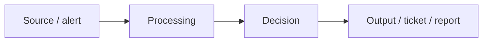

# <Project name>

> One sentence: what this does and who it helps.

 

## Problem
2–4 sentences. What security problem exists, why it matters, what it costs when handled manually. Write it the way you'd explain it to a hiring manager.

## What I built
- Bullet the components (playbook, queries, script, dashboard)
- Name the tech: Sentinel, Logic Apps, KQL, PowerShell, Python…

## Architecture
Diagram (draw.io / Mermaid / screenshot) showing data flow.



## How to run it
1. Prerequisites (roles, licenses, tools — with exact versions)
2. Deploy / install steps (copy-pasteable)
3. How to generate test data
4. Expected result

## Results
Screenshots and numbers **from the lab**. Example: "Triaged 50 synthetic phishing reports; 38 auto-closed as benign, 12 escalated, 0 false negatives against the labeled set."

## Framework mapping
| Control / technique | How this addresses it |
|---|---|
| MITRE ATT&CK T1566 (Phishing) | … |
| NIST CSF DE.AE / RS.AN | … |

## Risk view (CIA)
| Confidentiality | Integrity | Availability | Likelihood | Impact | Risk before → after |
|---|---|---|---|---|---|
|  |  |  |  |  |  |

## Limitations & what's next
Be honest — reviewers respect it. What would you add with more time or in production?

## Repo layout
```
/src        code, templates, queries
/docs       diagrams, screenshots
/sample     synthetic test data
```
